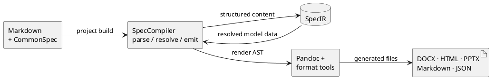

# SPEC: Introducing SpecCompiler

A short overview of SpecCompiler: turning structured Markdown into consistent, reusable engineering outputs.

## INDEX: Contents

## TITLE: From authoring to output

SpecCompiler turns engineering content into structured, traceable deliverables through a repeatable build pipeline.

## SLIDE: How SpecCompiler works

1. Read project settings and source documents
2. Parse content into the structured SpecIR database
3. Resolve links, references, and generated content
4. Emit documents through Pandoc and format-specific tooling

## SLIDE: One source, multiple outputs

```list-table:tbl-outputs{caption="SpecCompiler output formats"}
> header-rows: 1
> aligns: l,l

* - Format
  - Typical use
* - DOCX / PDF
  - Reports and controlled documents
* - HTML5
  - Searchable documentation sites
* - PPTX
  - Slide presentations
* - Markdown / JSON
  - Reuse and data exchange
```

## TITLE: Adapt SpecCompiler to your domain

Models let teams add their own vocabulary, rules, and rendering behavior while reusing the core build pipeline.

## SLIDE: Extend with models

- Define domain-specific objects, relations, and views
- Add format filters, styles, and postprocessors when needed
- Reuse a model across projects for consistent output

## SLIDE: SpecCompiler component flow

